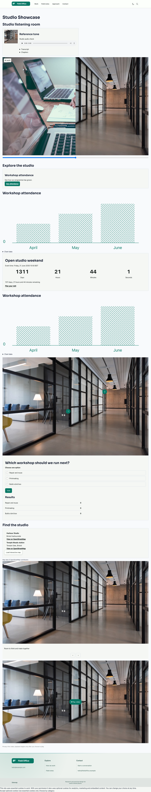

# Widget Showcase

<!-- prettier-ignore-start -->

## What It Does

Widget Showcase is a dependency bundle for the ten standalone Capell widget packages listed in its manifest. It does not register a provider, contribution, database schema, admin page, or frontend runtime surface of its own.

- **Price and availability:** Check current availability and price on the [Capell Marketplace listing](https://capell.app/extensions/widget-showcase).
- **Licence:** Check the licence terms on the [Capell Marketplace listing](https://capell.app/extensions/widget-showcase).
- **Requires:** `PHP ^8.4`, `capell-app/widget-audio-playlist ^1.0`, `capell-app/widget-before-after ^1.0`, `capell-app/widget-content-reveal ^1.0`, `capell-app/widget-countdown ^1.0`, `capell-app/widget-data-chart ^1.0`, `capell-app/widget-hotspots ^1.0`, `capell-app/widget-live-poll ^1.0`, `capell-app/widget-location-map ^1.0`, `capell-app/widget-slideshow ^1.0`, `capell-app/widget-youtube ^1.0`.
- **Install:** `composer require capell-app/widget-showcase`.

Installing the bundle makes its required widget packages available through their own registrations; Widget Showcase itself adds no runtime surface itself: no visible editor or public output.

## Who It Is For

**For developers:** The package keeps collection-level installation declarative and leaves every runtime contract inside the individual widget package.

**For teams:** Teams can require the curated widget set as one package while enabling and using each included widget through its own Capell surface.

## Quick Start

1. Install the package: `composer require capell-app/widget-showcase`.
2. Verify the package provider and manifest contributions are registered in the host app.

## Configure

This extension works without configuration. There is nothing to set after install.

## Limits And Pitfalls

- Install the required Capell packages at the versions in `composer.json`: `capell-app/widget-audio-playlist ^1.0`, `capell-app/widget-before-after ^1.0`, `capell-app/widget-content-reveal ^1.0`, `capell-app/widget-countdown ^1.0`, `capell-app/widget-data-chart ^1.0`, `capell-app/widget-hotspots ^1.0`, `capell-app/widget-live-poll ^1.0`, `capell-app/widget-location-map ^1.0`, `capell-app/widget-slideshow ^1.0`, `capell-app/widget-youtube ^1.0`.

## Screens And Workflow

- Widget Showcase extension card (marketplace).
- Installed widget showcase (frontend).

## Install Impact

- Required packages: `capell-app/widget-audio-playlist`, `capell-app/widget-before-after`, `capell-app/widget-content-reveal`, `capell-app/widget-countdown`, `capell-app/widget-data-chart`, `capell-app/widget-hotspots`, `capell-app/widget-live-poll`, `capell-app/widget-location-map`, `capell-app/widget-slideshow`, `capell-app/widget-youtube`.
- Admin navigation: no admin page or resource contribution is declared.
- Admin/editor extensions: none declared.
- Permissions: no package permission declarations or Shield gates detected; host access rules still apply.
- Public routes: none declared.
- Database changes: no package migrations declared.
- Config: no package config files.
- Settings: no package settings declared.
- Queues or schedules: none declared.
- Cache tags: none declared.
- Commands: none declared.

## Upgrading

No manual steps between minor versions.

## Next Steps

- [Package docs](docs/README.md)
- [Overview](docs/overview.md)
- [Developer reference](docs/reference.md)
- [Marketplace assets](docs/assets/marketplace/)
- [Capell content language plan](../../docs/CONTENT_LANGUAGE_PLAN.md)
- [Capell documentation design system](../../docs/DESIGN_SYSTEM.md)
- [Capell and package ERD notes](../../docs/erd/capell-and-package-erds.md)
- Related packages: [Audio Playlist Widget](../widget-audio-playlist/README.md), [Before and After Widget](../widget-before-after/README.md), [Content Reveal Widget](../widget-content-reveal/README.md), [Countdown Widget](../widget-countdown/README.md), [Data Chart Widget](../widget-data-chart/README.md), [Hotspots Widget](../widget-hotspots/README.md), [Live Poll Widget](../widget-live-poll/README.md), [Location Map Widget](../widget-location-map/README.md), [Slideshow Widget](../widget-slideshow/README.md), [YouTube Widget](../widget-youtube/README.md).

<!-- prettier-ignore-end -->
