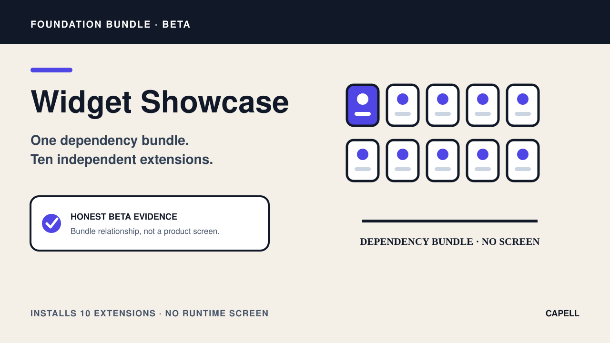

# Widget Showcase

<!-- prettier-ignore-start -->

## What This Plugin Adds

Widget Showcase is an **Available**, **No schema impact** Capell bundle in the **Capell Foundation** product group. It ships as `capell-app/widget-showcase` and extends these surfaces: none declared.

Widget Showcase is a dependency bundle for the ten standalone Capell widget packages listed in its manifest. It does not register a provider, contribution, database schema, admin page, or frontend runtime surface of its own.

Installing the bundle makes its required widget packages available through their own registrations; Widget Showcase itself adds no runtime surface itself: no visible editor or public output.

Evidence: [`capell.json`](capell.json), [`composer.json`](composer.json), [`tests/Unit/WidgetShowcaseManifestTest.php`](tests/Unit/WidgetShowcaseManifestTest.php).

Status details:

- Status: Available
- Tier: free
- Bundle: foundation
- Composer package: `capell-app/widget-showcase`
- Namespace: `Capell\WidgetShowcase`
- Theme key: not applicable

## Why It Matters

**For developers:** The package keeps collection-level installation declarative and leaves every runtime contract inside the individual widget package.

**For teams:** Teams can require the curated widget set as one package while enabling and using each included widget through its own Capell surface.

Evidence: [`capell.json`](capell.json), [`composer.json`](composer.json), [`tests/Unit/WidgetShowcaseManifestTest.php`](tests/Unit/WidgetShowcaseManifestTest.php).

## Screens And Workflow

Screenshot contract: `docs/screenshots.json`.

- Widget Showcase extension card (marketplace, required).

## Technical Shape

- Dependency bundle: requires `capell-app/widget-audio-playlist`, `capell-app/widget-before-after`, `capell-app/widget-content-reveal`, `capell-app/widget-countdown`, `capell-app/widget-data-chart`, `capell-app/widget-hotspots`, `capell-app/widget-live-poll`, `capell-app/widget-location-map`, `capell-app/widget-slideshow`, `capell-app/widget-youtube` and declares no package-owned provider or runtime classes.

## Data Model

This package has no schema impact. It delegates runtime behaviour to `capell-app/widget-audio-playlist`, `capell-app/widget-before-after`, `capell-app/widget-content-reveal`, `capell-app/widget-countdown`, `capell-app/widget-data-chart`, `capell-app/widget-hotspots`, `capell-app/widget-live-poll`, `capell-app/widget-location-map`, `capell-app/widget-slideshow`, and `capell-app/widget-youtube` and does not declare package-owned tables.

## Install Impact

- Required packages: `capell-app/widget-audio-playlist`, `capell-app/widget-before-after`, `capell-app/widget-content-reveal`, `capell-app/widget-countdown`, `capell-app/widget-data-chart`, `capell-app/widget-hotspots`, `capell-app/widget-live-poll`, `capell-app/widget-location-map`, `capell-app/widget-slideshow`, `capell-app/widget-youtube`.
- Admin navigation: no admin page or resource contribution is declared.
- Admin/editor extensions: none declared.
- Permissions: none declared in `capell.json`.
- Public routes: none declared.
- Database changes: no package migrations declared.
- Config: no package config files.
- Settings: no package settings declared.
- Queues or schedules: none declared.
- Cache tags: none declared.
- Commands: none declared.

## Common Pitfalls

- Keep required Capell packages on compatible v4 releases: `capell-app/widget-audio-playlist`, `capell-app/widget-before-after`, `capell-app/widget-content-reveal`, `capell-app/widget-countdown`, `capell-app/widget-data-chart`, `capell-app/widget-hotspots`, `capell-app/widget-live-poll`, `capell-app/widget-location-map`, and 2 more.

## Quick Start

1. Install the package: `composer require capell-app/widget-showcase`.
2. No package-specific setup command or migrations are declared.
3. Open the package detail or install-intent surface and confirm the Widget Showcase extension card is present.

## Next Steps

- [Package docs](docs/README.md)
- [Overview](docs/overview.md)
- [Screenshot contract](docs/screenshots.json)
- [Marketplace assets](docs/assets/marketplace/)
- [Capell content language plan](../../docs/CONTENT_LANGUAGE_PLAN.md)
- [Capell documentation design system](../../docs/DESIGN_SYSTEM.md)
- [Capell and package ERD notes](../../docs/erd/capell-and-package-erds.md)
- Related packages: [Widget Audio Playlist](../widget-audio-playlist/README.md), [Widget Before After](../widget-before-after/README.md), [Widget Content Reveal](../widget-content-reveal/README.md), [Widget Countdown](../widget-countdown/README.md), [Widget Data Chart](../widget-data-chart/README.md), [Widget Hotspots](../widget-hotspots/README.md), [Widget Live Poll](../widget-live-poll/README.md), [Widget Location Map](../widget-location-map/README.md), [Widget Slideshow](../widget-slideshow/README.md), [Widget Youtube](../widget-youtube/README.md).
- Focused tests: `vendor/bin/pest packages/widget-showcase/tests --configuration=phpunit.xml`.

<!-- prettier-ignore-end -->
